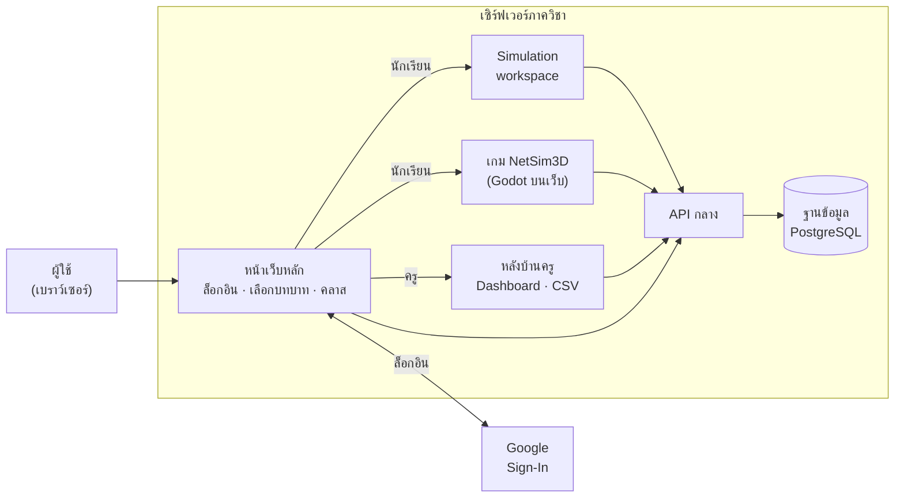
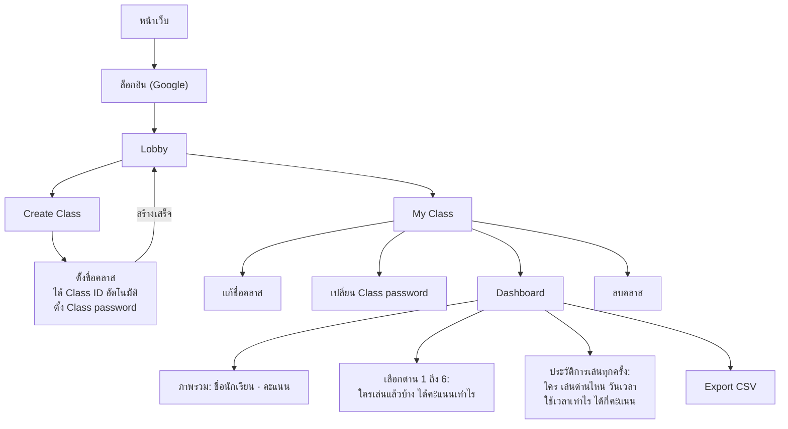
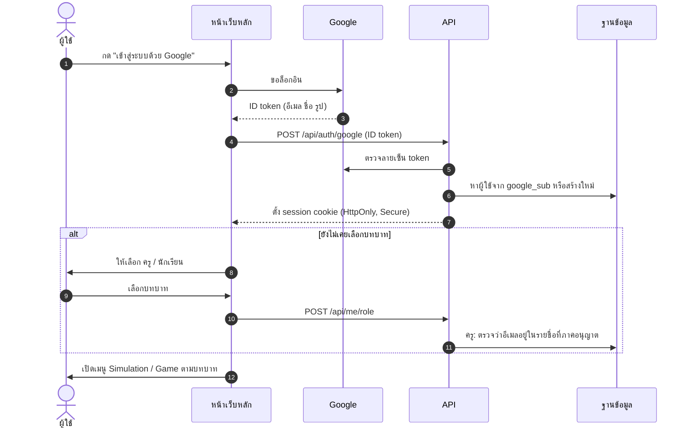
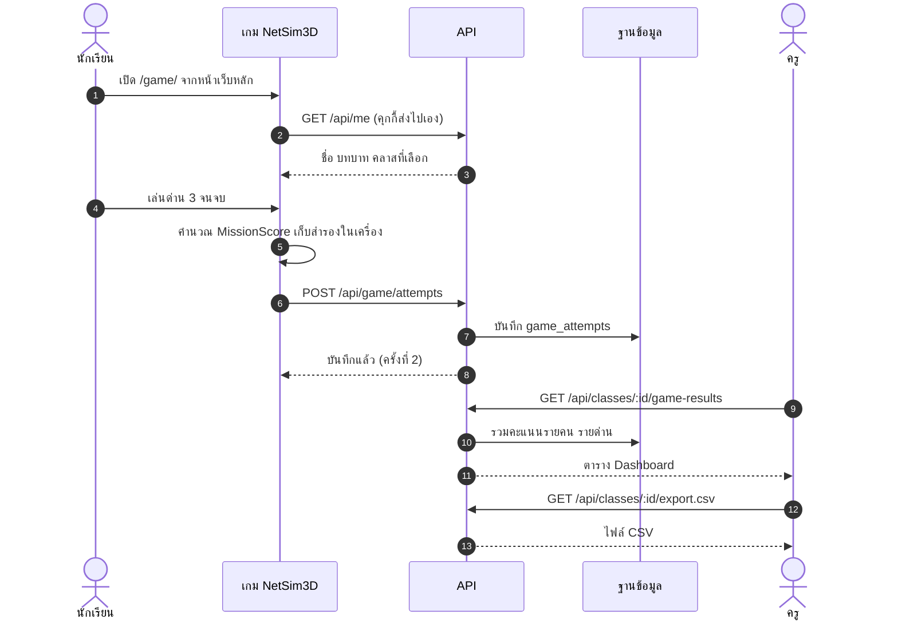
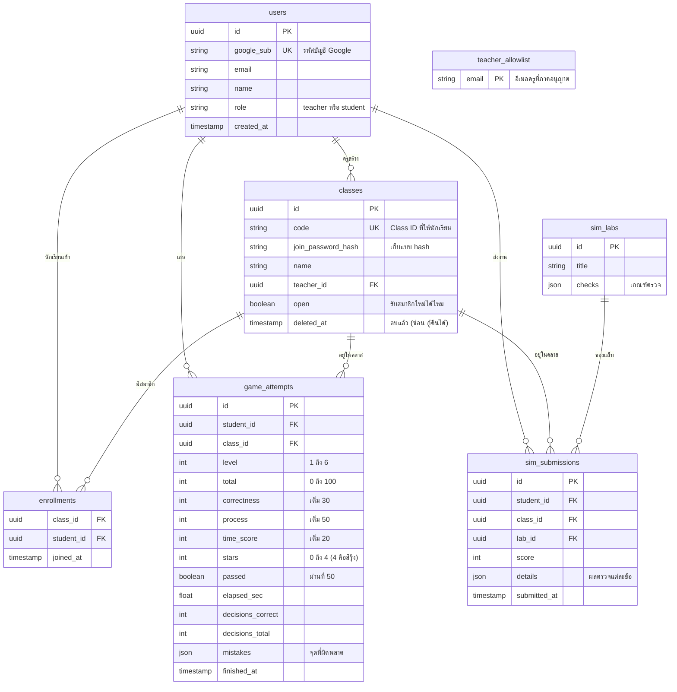
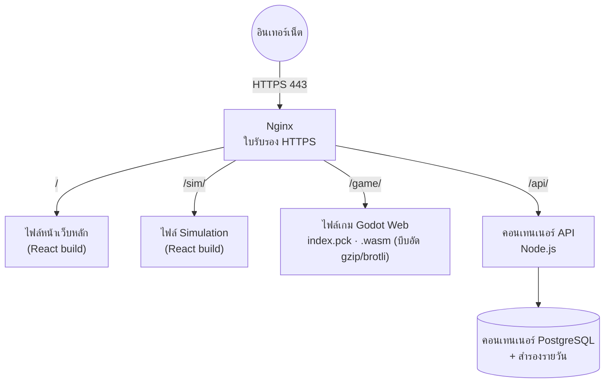

# แบบร่างโครงเว็บไซต์ NetSim

ร่างกรอบการทำงานของทั้งระบบ ตั้งแต่เข้าสู่ระบบด้วย Google จนครูเปิดดูคะแนนและดาวน์โหลด CSV ใช้คุยกับอาจารย์ที่ปรึกษาและเพื่อนร่วมโปรเจกต์ก่อนลงมือสร้าง ทุกส่วนวางบนเซิร์ฟเวอร์ของภาควิชา

- ร่างวันที่ 20 พ.ย. 2569 (ปรับปรุง 24 พ.ย. 2569)
- ส่วนที่มีแล้ว: เกม NetSim3D (Godot 4.7, เล่นบนเว็บ) อยู่ในโฟลเดอร์ [`net-sim-3d`](../net-sim-3d)
- ส่วนที่ต้องสร้าง: หน้าเว็บหลัก, Simulation, API, ฐานข้อมูล
- ฉบับหน้าเว็บที่จัดหน้าสวยกว่า: [`framework.html`](framework.html) (ดาวน์โหลดแล้วเปิดในเบราว์เซอร์)

> ร่างนี้ยังไม่ใช่สเปกสุดท้าย เทคโนโลยีในหัวข้อ 3 เป็นข้อแนะนำ ปรับได้ตามที่เซิร์ฟเวอร์ภาคมีให้

## 1. ภาพรวมทั้งระบบ

ผู้ใช้ทุกคนเข้าทางหน้าเว็บหลักที่เดียว ล็อกอินด้วยบัญชี Google แล้วระบบพาไปตามบทบาท นักเรียนเลือกเข้า Simulation หรือ Game ส่วนครูเข้าหลังบ้านเพื่อดูคะแนน ทุกส่วนเรียก API ตัวเดียวกันและเก็บข้อมูลในฐานข้อมูลเดียวกัน

## 2. ผู้ใช้แต่ละบทบาททำอะไรบ้าง

**นักเรียน**
1. กด "เข้าสู่ระบบด้วย Google"
2. ครั้งแรก: เลือกบทบาท "นักเรียน"
3. กรอก Class ID และรหัสผ่านคลาสที่ครูให้ เพื่อเข้าคลาส (เข้าได้หลายคลาส)
4. เลือก Simulation เข้าหน้า workspace หรือ Game เข้าเมนูเกม
5. เล่นเกมเรียงด่าน 1 ถึง 6 และกลับไปเล่นด่านที่ผ่านแล้วซ้ำได้ (เกมทำได้อยู่แล้ว)
6. เล่นจบด่าน เกมส่งคะแนนขึ้นระบบให้เอง หน้า "ความคืบหน้า" ในเกมเห็นผลของตัวเองทุกครั้ง ไม่ว่าเล่นจากเครื่องไหน

**ครู**
1. กด "เข้าสู่ระบบด้วย Google"
2. ครั้งแรก: เลือกบทบาท "ครู" (ใช้ได้เฉพาะอีเมลที่ภาคอนุญาต ดูหัวข้อ 9)
3. สร้างคลาส ระบบสร้าง Class ID ให้ ครูตั้งรหัสผ่านคลาส แล้วแจ้งนักเรียน
4. กด Simulation หรือ Game เข้าหลังบ้านของส่วนนั้น
5. Dashboard: คะแนนทุกคนในคลาส รายด่าน/แล็บ รายครั้ง จุดที่ผิดพลาด แล้วกด Export CSV
6. จัดการคลาส: แก้ชื่อ เปลี่ยนรหัสผ่าน หรือลบคลาส

### โครงหน้าเว็บฝั่งครู

**Dashboard แสดงคะแนนอย่างไร**
- บันทึกทุกครั้งที่เล่น พร้อมวันเวลา จึงรู้ว่าครั้งไหนเป็นครั้งแรก
- ตารางสรุปแต่ละคน แสดง 3 ค่า: ครั้งแรก (วัดความเข้าใจตอนเริ่ม), ดีที่สุด, ล่าสุด และจำนวนครั้งที่เล่น
- เลือกด่าน 1 ถึง 6 เพื่อดูว่าใครเล่นแล้ว ใครยังไม่เล่น
- กดชื่อนักเรียนเพื่อดูประวัติทุกครั้ง และจุดที่ผิดพลาดแต่ละครั้ง

**เรื่องที่ควรตกลงเพิ่ม**
- ลบคลาส: ให้ยืนยันก่อน และเก็บคะแนนไว้แบบซ่อน (กู้คืนได้) ดีกว่าลบทิ้งทันที
- เปลี่ยนรหัสผ่านคลาส: มีผลกับคนที่จะเข้าใหม่เท่านั้น นักเรียนที่อยู่ในคลาสแล้วไม่ถูกถอดออก
- "สร้างบัญชี": ล็อกอิน Google ครั้งแรกถือเป็นการสร้างบัญชี ไม่ต้องตั้งรหัสผ่านเอง
- ฝั่งนักเรียน: Lobby มี Join Class, เลือกคลาส, เข้าเกม และดูคะแนนตัวเอง

## 3. Framework และเทคโนโลยีที่แนะนำ

ทั้งระบบเขียนด้วย JavaScript/TypeScript ภาษาเดียว (ยกเว้นเกมที่เป็น Godot อยู่แล้ว) ทีมเล็กดูแลง่าย และรันบนเซิร์ฟเวอร์ Linux ทั่วไปด้วย Docker

| ส่วน | หน้าที่ | แนะนำ | ทางเลือก |
|---|---|---|---|
| หน้าเว็บหลัก (สร้างใหม่) | ล็อกอิน, เลือกบทบาท, สร้าง/เข้าคลาส, เมนู Simulation/Game, หลังบ้านครู | React + Vite + TypeScript, React Router | Next.js |
| Simulation workspace | ลากวางอุปกรณ์ ต่อสาย ตั้งค่า IP ทดสอบ ping แบบ Cisco Packet Tracer | React + React Flow + ตัวจำลองเครือข่ายเขียนเองใน TypeScript | Konva/Canvas |
| เกม NetSim3D (มีแล้ว) | 6 ด่าน คะแนน 30/50/20 ประวัติการเล่น จุดที่ผิดพลาด | Godot 4.7 ส่งออกเป็น Web วางเป็นไฟล์ static | — |
| API กลาง (สร้างใหม่) | ตรวจตัวตน, สิทธิ์ตามบทบาท, คลาส, รับคะแนน, Dashboard, CSV | Node.js + Fastify (หรือ Express) + Prisma | Python FastAPI + SQLAlchemy |
| ฐานข้อมูล (สร้างใหม่) | ผู้ใช้ คลาส สมาชิก คะแนนเกม คะแนน Simulation | PostgreSQL 16 | MySQL/MariaDB ถ้าภาคมีให้อยู่แล้ว |
| เข้าสู่ระบบ | บัญชี Google | Google Identity Services (OpenID Connect) ตรวจ ID token ที่ API แล้วออก session cookie | Auth.js / Passport |
| เว็บเซิร์ฟเวอร์ | HTTPS, แบ่งเส้นทาง, ส่งไฟล์เกมแบบบีบอัด | Nginx + Let's Encrypt (หรือใบรับรองของมหาวิทยาลัย) | Caddy |
| ติดตั้ง | ยกทั้งระบบขึ้นเซิร์ฟเวอร์ด้วยคำสั่งเดียว | Docker Compose (nginx, api, db) | ติดตั้งตรงบนเครื่อง |

ทุกส่วนอยู่โดเมนเดียวกัน แบ่งด้วยเส้นทาง: `/` หน้าเว็บหลัก · `/sim/` Simulation · `/game/` เกม · `/api/` API คุกกี้ล็อกอินจึงใช้ร่วมกันได้ทันที เกมไม่ต้องล็อกอินซ้ำ

## 4. ขั้นตอนเข้าสู่ระบบและเลือกบทบาท

## 5. นักเรียนเล่นเกม แล้วคะแนนไปถึงครูอย่างไร

เกมคำนวณคะแนนเหมือนเดิมทุกอย่าง (ความถูกต้อง 30 · กระบวนการ 50 · เวลา 20 ดาว และจุดที่ผิดพลาด) ที่เพิ่มคือส่งผลแต่ละครั้งขึ้น API ถ้าเน็ตหลุด เกมเก็บไว้ในเครื่องก่อนแล้วส่งใหม่ภายหลัง

## 6. ฐานข้อมูล

ตารางคะแนนเกมเก็บตรงกับที่เกมบันทึกอยู่แล้วในเครื่อง (`GameProgress` และ `MissionScore`) จึงย้ายขึ้นเซิร์ฟเวอร์ได้โดยไม่ต้องเปลี่ยนวิธีคิดคะแนน ส่วน Simulation เว้นช่องรายละเอียดเป็น JSON ไว้ จนกว่าจะตกลงกันว่าเก็บคะแนนแบบไหน

## 7. API ที่ต้องมี

| คำขอ | เส้นทาง | ใครเรียก | ทำอะไร |
|---|---|---|---|
| POST | `/api/auth/google` | ทุกคน | รับ ID token จาก Google ตรวจแล้วออก session |
| POST | `/api/auth/logout` | ทุกคน | ออกจากระบบ |
| GET | `/api/me` | ทุกคน, เกม | ชื่อ บทบาท คลาสที่อยู่ |
| POST | `/api/me/role` | ผู้ใช้ใหม่ | เลือกบทบาทครั้งแรก (ครูต้องอยู่ใน allowlist) |
| POST | `/api/classes` | ครู | สร้างคลาส ได้ Class ID ตั้งรหัสผ่าน |
| GET | `/api/classes` | ครู, นักเรียน | คลาสของฉัน |
| PATCH | `/api/classes/:id` | ครูเจ้าของคลาส | แก้ชื่อคลาส, เปลี่ยนรหัสผ่าน, เปิด/ปิดรับสมาชิก |
| DELETE | `/api/classes/:id` | ครูเจ้าของคลาส | ลบคลาส (ซ่อนไว้ กู้คืนได้) |
| POST | `/api/classes/join` | นักเรียน | เข้าคลาสด้วย Class ID + รหัสผ่าน |
| POST | `/api/game/attempts` | เกม | ส่งผลการเล่นหนึ่งครั้ง |
| GET | `/api/game/attempts/me` | เกม | ประวัติของฉัน (หน้า "ความคืบหน้า" ในเกม) |
| POST | `/api/sim/submissions` | Simulation | ส่งผลแล็บ |
| GET | `/api/classes/:id/game-results` | ครูเจ้าของคลาส | Dashboard เกม |
| GET | `/api/classes/:id/sim-results` | ครูเจ้าของคลาส | Dashboard Simulation |
| GET | `/api/classes/:id/export.csv` | ครูเจ้าของคลาส | ดาวน์โหลด CSV (เกม, Simulation, ทั้งหมด) |

CSV หนึ่งแถวต่อการเล่นหนึ่งครั้ง: รหัสนักศึกษา/อีเมล, ชื่อ, ด่าน, ครั้งที่, คะแนนรวม, ความถูกต้อง, กระบวนการ, เวลา, ดาว, ผ่าน/ไม่ผ่าน, เวลาที่ใช้, จุดที่ผิดพลาด, วันเวลา บันทึกเป็น UTF-8 แบบมี BOM เพื่อให้ Excel เปิดภาษาไทยได้ถูก

## 8. เอาเกมขึ้นเว็บ และสิ่งที่ต้องเพิ่มในเกม

**ไม่ต้องฝากเกมไว้ที่อื่น** เกมส่งออกจาก Godot เป็นไฟล์ static ธรรมดา (index.html, .js, .wasm ประมาณ 40 MB, .pck ประมาณ 141 MB) วางเป็นโฟลเดอร์ `/game/` บนเซิร์ฟเวอร์เดียวกับเว็บได้เลย
- อยู่โดเมนเดียวกับเว็บ เกมใช้ session ที่ล็อกอินไว้ได้ทันที ไม่ต้องส่ง token ข้ามโดเมนหรือตั้ง CORS
- ในเกมมีปุ่มกลับหน้า lobby อยู่แล้ว (`application/web_lobby_url` ค่าเริ่มต้น `../`) ตรงกับโครงสร้างนี้
- ตอน export ปิด thread support ไว้ จึงไม่ต้องตั้ง header COOP/COEP
- เซิร์ฟเวอร์ต้องส่ง `.wasm` เป็น `application/wasm` เปิดบีบอัด gzip/brotli และเปิด cache ให้เบราว์เซอร์
- ข้อควรระวัง: นักเรียน 40 คนเปิดพร้อมกันครั้งแรก เซิร์ฟเวอร์ต้องส่งข้อมูลรวมราว 7 GB ถ้าเครือข่ายภาครับไม่ไหว ค่อยย้ายเฉพาะ `.pck` และ `.wasm` ไปฝาก CDN แต่ index.html ยังอยู่บนเว็บภาค

ด่าน ภารกิจ และวิธีคิดคะแนนไม่เปลี่ยน เพิ่มเฉพาะการเชื่อมกับระบบ

**ตอนเปิดเกม**
- เรียก `GET /api/me` ถ้ามี session แสดงชื่อและคลาสที่มุมเมนู
- ถ้าไม่มี session (เปิดเกมตรง ๆ) ขึ้นปุ่ม "เข้าสู่ระบบ" พากลับหน้าเว็บหลัก
- ตั้งค่าเกม (ภาษา เสียง ภาพ) ยังเก็บในเครื่องเหมือนเดิม

**ตอนเล่นจบด่าน**
- `GameProgress.record_attempt` เก็บในเครื่องเหมือนเดิม แล้วส่ง `POST /api/game/attempts`
- ส่งไม่สำเร็จ: เข้าคิวในเครื่อง แล้วลองส่งใหม่ตอนเปิดเกมหรือจบด่านถัดไป
- ใช้ `HTTPRequest` ของ Godot เรียก API โดเมนเดียวกัน คุกกี้ไปเอง

**หน้า "ความคืบหน้า"**
- อ่านประวัติจาก `GET /api/game/attempts/me` เห็นผลเดียวกันทุกเครื่อง
- หน้าตาเดิมทั้งหมด (กราฟ ตาราง จุดที่ผิดพลาด)
- ถ้าออฟไลน์ แสดงจากข้อมูลในเครื่อง

## 9. ความปลอดภัยและข้อมูลส่วนบุคคล

> **เรื่องที่ต้องตัดสินใจ:** ถ้าใครก็กดเลือกบทบาทครูได้ นักเรียนจะสร้างคลาสหรือเข้าไปดูคะแนนคนอื่นได้ แนะนำให้บทบาทครูใช้ได้เฉพาะอีเมลในรายชื่อที่ภาคกำหนด (ตาราง `teacher_allowlist`) หรือให้แอดมินอนุมัติ

- รหัสผ่านคลาสเก็บแบบ hash (bcrypt) และจำกัดจำนวนครั้งที่ลองผิด เช่น 5 ครั้งต่อ 10 นาที
- ครูเห็นเฉพาะคลาสของตัวเอง นักเรียนเห็นเฉพาะผลของตัวเอง ตรวจสิทธิ์ที่ API ทุกคำขอ ไม่พึ่งการซ่อนปุ่มในหน้าเว็บ
- Session cookie แบบ `HttpOnly`, `Secure`, `SameSite=Lax` ทุกอย่างผ่าน HTTPS
- เก็บข้อมูลส่วนตัวเท่าที่ต้องใช้ (ชื่อ อีเมล) อยู่บนเซิร์ฟเวอร์ภาค สอดคล้อง PDPA และแจ้งนักเรียนในหน้าแรกว่าเก็บอะไรบ้าง
- สำรองฐานข้อมูลอัตโนมัติทุกวัน

## 10. ติดตั้งบนเซิร์ฟเวอร์ภาควิชา

- **แผน A (เซิร์ฟเวอร์รัน Docker ได้):** ยกทั้งระบบด้วย `docker compose up -d` ข้อมูลทั้งหมดอยู่ในภาค ดูแลและย้ายเครื่องง่าย
- **แผน B (วางได้แค่ไฟล์เว็บ):** หน้าเว็บ เกม และ Simulation วางบนเซิร์ฟเวอร์ภาค ส่วนล็อกอินและฐานข้อมูลใช้ Supabase (มี Google login ในตัว) แต่ข้อมูลนักเรียนจะอยู่บนคลาวด์นอกมหาวิทยาลัย ต้องถามอาจารย์ก่อน

## 11. ลำดับการสร้าง

| ระยะ | งาน | เสร็จแล้วได้อะไร |
|---|---|---|
| 1 | ตั้งเซิร์ฟเวอร์: Nginx, HTTPS, Docker, ฐานข้อมูลเปล่า, วางเกมที่ `/game/` | เปิดเกมจากเซิร์ฟเวอร์ภาคได้ (ยังเก็บผลในเครื่อง) |
| 2 | API + Google login + เลือกบทบาท + allowlist ครู | ล็อกอินได้ แยกครูกับนักเรียน |
| 3 | คลาส: สร้าง, Class ID + รหัสผ่าน, เข้าคลาส, แก้ชื่อ, เปลี่ยนรหัสผ่าน, ลบ | ครูมีนักเรียนในคลาส จัดการคลาสได้ |
| 4 | เกมส่งผลขึ้น API + หน้าความคืบหน้าอ่านจากเซิร์ฟเวอร์ | คะแนนเกมเข้าฐานข้อมูลจริง |
| 5 | หลังบ้านครู: Dashboard เกม + Export CSV | ครูดูและส่งออกคะแนนเกมได้ |
| 6 | Simulation workspace + ส่งผลแล็บ + Dashboard Simulation | ครบทั้งสองส่วน |

## 12. คำถามถึงอาจารย์ (ต้องได้คำตอบก่อนเริ่ม)

**เรื่องเซิร์ฟเวอร์**
1. เซิร์ฟเวอร์ใช้ระบบปฏิบัติการอะไร และจะได้สิทธิ์เข้าไปติดตั้งโปรแกรมเองไหม (เช่น SSH) หรือต้องส่งไฟล์ให้ผู้ดูแลติดตั้ง
2. รันโปรแกรมฝั่ง backend ได้ไหม เช่น Node.js, Python, PHP หรือ Docker หรือวางได้แค่ไฟล์เว็บธรรมดา
3. มีฐานข้อมูลให้ใช้ไหม (เช่น MySQL หรือ PostgreSQL) หรือต้องติดตั้งเอง
4. เว็บจะได้โดเมนอะไร และมี HTTPS ไหม (Google login บังคับต้องใช้ HTTPS)
5. พื้นที่และความเร็วเครือข่ายพอไหม ไฟล์เกมประมาณ 180 MB ถ้านักเรียนทั้งห้องเปิดพร้อมกันครั้งแรกจะใช้ bandwidth รวมหลาย GB
6. นักเรียนต้องเข้าเว็บจากนอกมหาวิทยาลัยได้ไหม หรือใช้แค่ในเครือข่ายมหาวิทยาลัย

**เรื่องขอบเขตงาน**

7. ส่วน Simulation ใครเป็นคนทำ ต้องทำเองด้วย หรือมีคนอื่นทำแล้วแค่เชื่อมเข้าเว็บ
8. Dashboard ของครูต้องแสดงอะไรบ้าง ถ้าเล่นซ้ำ เก็บทุกครั้ง หรือเก็บแค่ครั้งที่ดีที่สุด
9. ใครเป็นครูได้บ้าง ใช้รายชื่ออีเมลครูที่อนุญาตไว้ล่วงหน้า หรือให้แอดมินอนุมัติ ใครเป็นแอดมิน
10. จำกัดให้ล็อกอินได้เฉพาะอีเมลของมหาวิทยาลัยไหม และใครเป็นคนสร้าง OAuth Client ใน Google Cloud (ภาค หรือนักศึกษา)
11. Simulation แต่ละแล็บตรวจอะไร ให้คะแนนแบบไหน ต้องมีประวัติรายครั้งเหมือนเกมไหม
12. CSV ต้องมีรหัสนักศึกษาไหม (บัญชี Google อาจไม่มี) ถ้าต้องมี ให้นักเรียนกรอกครั้งแรกตอนเข้าคลาส
