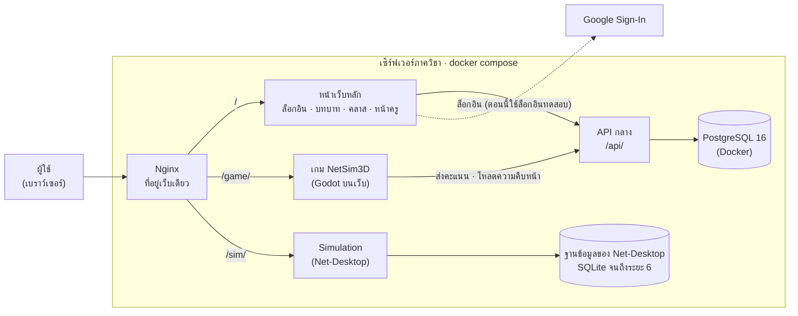
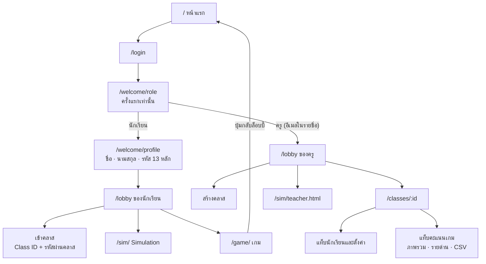
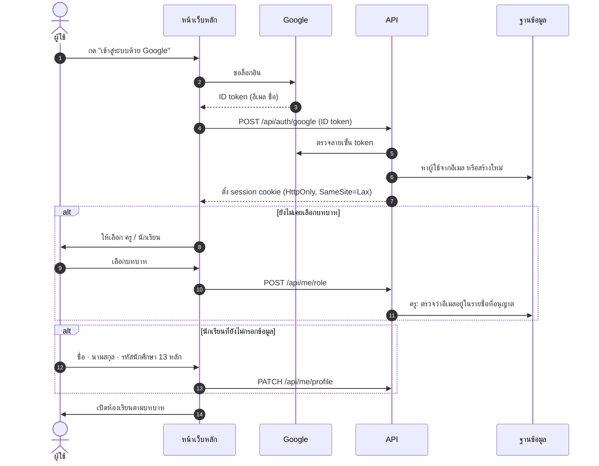
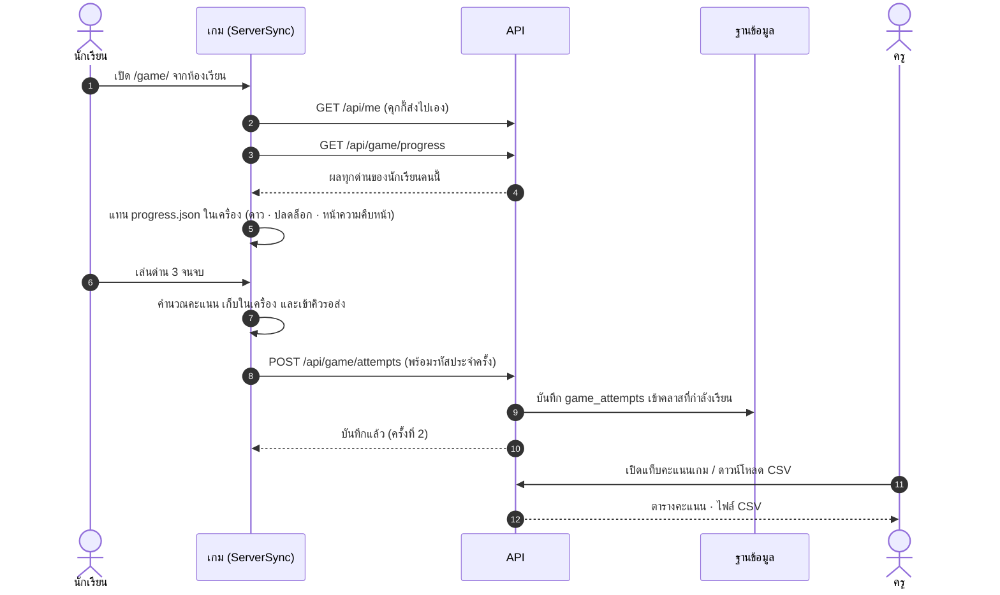
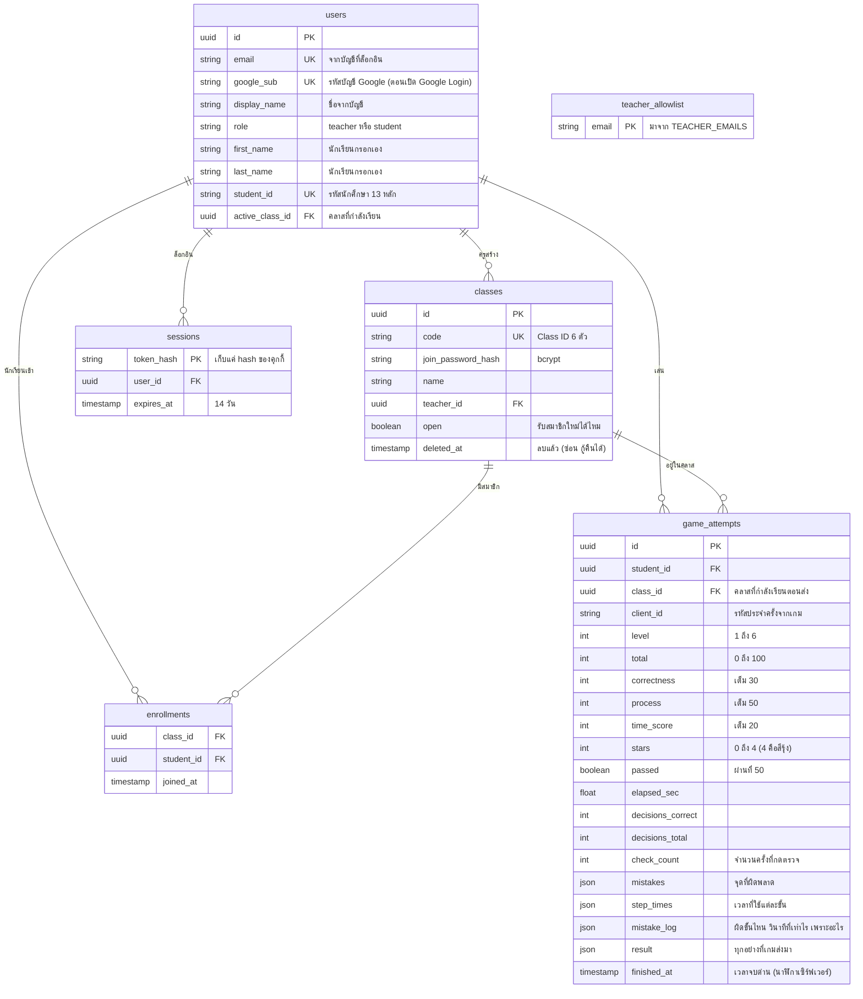
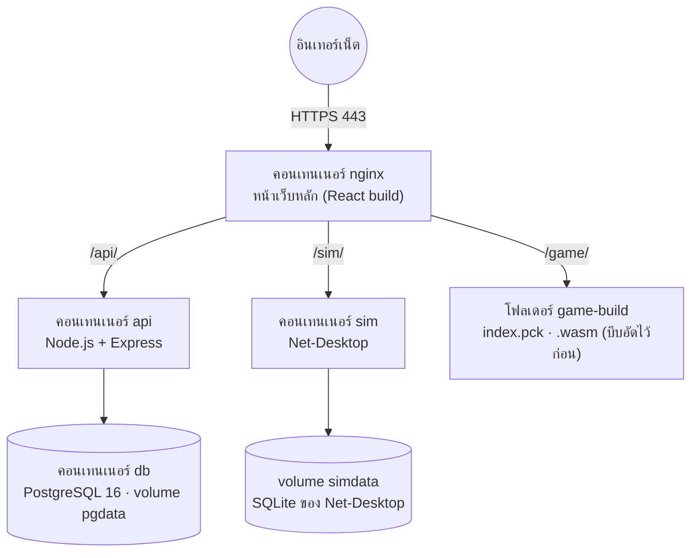

# โครงเว็บไซต์ NetSim

กรอบการทำงานของทั้งระบบ ตั้งแต่เข้าสู่ระบบจนครูเปิดดูคะแนนและดาวน์โหลด CSV ใช้คุยกับอาจารย์ที่ปรึกษาและเพื่อนร่วมโปรเจกต์ ทุกส่วนวางบนเซิร์ฟเวอร์ของภาควิชา

ใช้กับนักเรียนชั้น ปวช.3 ส่วน Simulation (Net-Desktop) ใช้ประกอบการสอนและวัดผลการเรียน ส่วนเกม NetSim3D ใช้วัดผลอย่างเดียว

- ร่างวันที่ 20 พ.ย. 2569 · ปรับให้ตรงกับระบบที่สร้างจริง 25 พ.ย. 2569
- **สร้างแล้ว (ระยะ 1–5):** โค้ดอยู่ในโฟลเดอร์ [`web-portal`](../web-portal) บน branch `claude/web-portal` วิธีเปิดระบบดูที่ [`web-portal/README.md`](../web-portal/README.md)
- **ยังต้องทำ:** Google Login จริง, ติดตั้งบนเซิร์ฟเวอร์ภาคพร้อม HTTPS และสำรองข้อมูลรายวัน, เชื่อม Net-Desktop เข้าระบบกลาง (ระยะ 6 หลังแก้ตามคอมเม้นอาจารย์)
- ฉบับหน้าเว็บที่จัดหน้าสวยกว่า: [`framework.html`](framework.html) (ดาวน์โหลดแล้วเปิดในเบราว์เซอร์)

## 1. ภาพรวมทั้งระบบ

ผู้ใช้ทุกคนเข้าทางที่อยู่เว็บเดียว Nginx แบ่งเส้นทางไปแต่ละส่วน หน้าเว็บหลักกับเกมใช้ API และฐานข้อมูลกลางร่วมกัน ส่วน Net-Desktop ยังใช้ล็อกอินและฐานข้อมูลของตัวเองจนถึงระยะ 6

## 2. แผนผังหน้าเว็บ

| เส้นทาง | หน้า | ใครเห็น | สถานะ |
|---|---|---|---|
| `/` | หน้าแรก: แนะนำระบบ ปุ่มเข้าสู่ระบบ ประกาศว่าเก็บข้อมูลอะไร | ทุกคน | ✅ |
| `/login` | เข้าสู่ระบบ: ปุ่ม Google และล็อกอินทดสอบ (ใช้ตอนพัฒนาเท่านั้น) | ทุกคน | ✅ (Google ยังไม่เปิด) |
| `/welcome/role` | เลือกบทบาทครั้งเดียว ครูเลือกได้เฉพาะอีเมลในรายชื่อที่อนุญาต | ผู้ใช้ใหม่ | ✅ |
| `/welcome/profile` | ข้อมูลนักเรียน: ชื่อ, นามสกุล, รหัสนักศึกษา 13 หลัก (แก้ภายหลังได้จากปุ่ม "ข้อมูลของฉัน") | นักเรียน | ✅ |
| `/lobby` | ห้องเรียนนักเรียน: คลาสที่กำลังเรียน, เข้าคลาส, คลาสของฉัน, ปุ่มเข้า Simulation และเกม | นักเรียน | ✅ |
| `/lobby` | ห้องเรียนครู: สร้างคลาส, คลาสของฉัน, คลาสที่ลบแล้ว (กู้คืน), เครื่องมือครู | ครู | ✅ |
| `/classes/:id` | หน้าคลาส แท็บ "นักเรียนและตั้งค่า": Class ID พร้อมปุ่มคัดลอก, รายชื่อนักเรียน, นำออก, แก้ชื่อ, เปลี่ยนรหัสผ่าน, เปิด/ปิดรับสมาชิก, ลบคลาส | ครูเจ้าของคลาส | ✅ |
| `/classes/:id?tab=game` | หน้าคลาส แท็บ "คะแนนเกม": ภาพรวม 6 ด่าน, รายด่าน, ประวัติรายคน, ดาวน์โหลด CSV | ครูเจ้าของคลาส | ✅ |
| `/game/` | เกม NetSim3D | นักเรียน (ครูทดลองเล่นได้) | ✅ |
| `/sim/` | Simulation (Net-Desktop) | นักเรียน | ✅ (ยังใช้ล็อกอินของตัวเอง) |
| `/sim/teacher.html` | หน้าครูของ Net-Desktop: ผลก่อน–หลังเรียน ภารกิจ CSV | ครู | ✅ (ยังใช้รหัสผ่านครูของตัวเอง) |
| ไม่มีหน้าแอดมิน | รายชื่ออีเมลครูตั้งไว้ในค่า `TEACHER_EMAILS` ของเซิร์ฟเวอร์ | ผู้ดูแลระบบ | ✅ |

**การไปมาระหว่างหน้า**
- หน้าที่ต้องล็อกอินจะพาไป `/login` ก่อน ถ้ายังไม่เลือกบทบาทหรือยังไม่กรอกข้อมูลนักเรียน จะพาไปหน้านั้นก่อนเสมอ
- คลาสแรกที่นักเรียนเข้าจะเป็น "คลาสที่กำลังเรียน" ให้อัตโนมัติ เปลี่ยนได้ที่ห้องเรียน คะแนนเกมเข้าคลาสนี้
- ปุ่ม Simulation และเกมในห้องเรียนกดได้เมื่อเข้าคลาสแล้ว
- ปุ่ม "กลับล็อบบี้" ในเกมพากลับหน้าแรก ซึ่งจะมีปุ่ม "ไปที่ห้องเรียนของฉัน"
- Net-Desktop ยังไม่มีลิงก์กลับเว็บหลัก (ทำในระยะ 6)
- ทุกหน้าสลับไทย/English ได้ หน้าตาเข้าชุดกับเกม (ฟอนต์ Mitr ภาพโรงเรียนซากุระ แผงกระจก) และใช้บนมือถือได้

## 3. ผู้ใช้แต่ละบทบาททำอะไรบ้าง

**นักเรียน**
1. กด "เข้าสู่ระบบ" (ตอนนี้ใช้ล็อกอินทดสอบ ภายหลังเป็น Google)
2. ครั้งแรก: เลือกบทบาท "นักเรียน" แล้วกรอกชื่อ นามสกุล และรหัสนักศึกษา 13 หลัก (อีเมลได้จากบัญชีที่ล็อกอิน)
3. เข้าคลาสด้วย Class ID และรหัสผ่านคลาสที่ครูให้ (เข้าได้หลายคลาส เลือกคลาสที่กำลังเรียนได้)
4. กด Simulation เพื่อเรียนและฝึก หรือกดเกมเพื่อทำภารกิจวัดผล
5. เล่นเกมเรียงด่าน 1 ถึง 6 และกลับไปเล่นด่านที่ผ่านแล้วซ้ำได้
6. จบด่านแล้วเกมส่งคะแนนให้ครูเอง หน้า "ความคืบหน้า" ในเกมเห็นผลของตัวเองเหมือนกันทุกเครื่อง

**ครู**
1. กด "เข้าสู่ระบบ" แล้วเลือกบทบาท "ครู" (เฉพาะอีเมลในรายชื่อที่อนุญาต)
2. สร้างคลาส: ระบบสร้าง Class ID 6 ตัวอักษรให้ (ไม่มีตัวที่สับสนง่ายอย่าง 0/O, 1/I) ครูตั้งรหัสผ่านคลาส แล้วแจ้งนักเรียน
3. หน้าคลาส: ดูรายชื่อ นำนักเรียนออก แก้ชื่อคลาส เปลี่ยนรหัสผ่าน เปิด/ปิดรับสมาชิก ลบหรือกู้คืนคลาส
4. แท็บ "คะแนนเกม": ดูคะแนนทุกคน รายด่าน รายครั้ง จุดที่ผิดพลาด แล้วดาวน์โหลด CSV
5. ผลของ Simulation ดูที่หน้าครูของ Net-Desktop ไปก่อน (รวมเข้าหน้าคลาสในระยะ 6)

**แท็บคะแนนเกมแสดงอะไร**
- ภาพรวม: นักเรียน × 6 ด่าน แต่ละช่องเป็นคะแนนดีที่สุดพร้อมดาวและจำนวนครั้ง (ผ่านสีเขียว ไม่ผ่านสีแดง)
- รายด่าน: เล่นแล้วกี่คน ผ่านกี่คน คะแนนดีที่สุดเฉลี่ย และของแต่ละคน: ครั้งแรก (วัดความเข้าใจตอนเริ่ม), ดีที่สุด, ล่าสุด, จำนวนครั้ง, เล่นล่าสุดเมื่อ คนที่ยังไม่เล่นขึ้นก่อน
- กดชื่อนักเรียน: ทุกครั้งที่เล่น คะแนนแต่ละส่วน เวลาแต่ละขั้น และจุดที่ผิดพร้อมเหตุผลและวินาทีที่ผิด
- นักเรียนที่ถูกนำออกจากคลาสยังเห็นผลเดิม มีป้าย "ออกจากคลาสแล้ว"

**ที่ตกลงและทำแล้ว**
- ลบคลาส: ต้องกดยืนยัน ซ่อนไว้ ข้อมูลและคะแนนยังอยู่ กู้คืนได้
- เปลี่ยนรหัสผ่านคลาส หรือปิดรับสมาชิก: นักเรียนที่อยู่ในคลาสแล้วยังอยู่เหมือนเดิม
- ล็อกอินครั้งแรกถือเป็นการสร้างบัญชี ไม่ต้องตั้งรหัสผ่านเอง
- เลือกบทบาทได้ครั้งเดียว

## 4. เทคโนโลยีที่ใช้จริง

| ส่วน | ใช้ | หมายเหตุ |
|---|---|---|
| หน้าเว็บหลัก | React 19 + Vite + TypeScript + React Router | ไทย/อังกฤษ, ฟอนต์และภาพจากเกม |
| API กลาง | Node.js 24 + Express 5 + TypeScript, pg, zod, bcryptjs | แบบเดียวกับ Net-Desktop เพื่อนอ่านต่อได้ Node 24 รันไฟล์ .ts ได้เลยไม่ต้อง build |
| ฐานข้อมูล | PostgreSQL 16 ในคอนเทนเนอร์ Docker | ตารางสร้างอัตโนมัติจากไฟล์ `migrations/` ตอนเปิด API |
| Simulation | Net-Desktop (HTML/JS + Express + SQLite) จากรีโป [Mxles-Arm/Net-Desktop](https://github.com/Mxles-Arm/Net-Desktop) | ไม่แก้โค้ดเพื่อน ยกเว้นเปลี่ยน `/api/` เป็น `api/` อัตโนมัติตอนสร้างคอนเทนเนอร์ |
| เกม | Godot 4.7 ส่งออกเป็น Web + autoload `ServerSync` | ด่านและวิธีคิดคะแนนเหมือนเดิม |
| เข้าสู่ระบบ | ตอนนี้: ล็อกอินทดสอบ (`DEV_LOGIN`) · จริง: Google Identity Services | Google รอ OAuth Client |
| เว็บเซิร์ฟเวอร์ | Nginx | บีบอัดไฟล์เกมไว้ก่อน (`.wasm` 37.7 MB เหลือ 9.7 MB) |
| ติดตั้ง | Docker Compose: `nginx`, `api`, `db`, `sim` | คำสั่งเดียว `docker compose up -d --build` |
| ทดสอบ | API 48 ข้อ (node:test + supertest), เกมกับเว็บ 15 ข้อ (`tools/check_server_sync.gd`) | |

ทุกส่วนอยู่โดเมนเดียวกัน คุกกี้ล็อกอินจึงใช้ร่วมกันได้ เกมไม่ต้องล็อกอินซ้ำ

> เปลี่ยนจากร่างแรก: ใช้ Express แทน Fastify + Prisma (ให้เหมือน Net-Desktop) และใช้ Net-Desktop เป็น Simulation แทนการสร้างใหม่ด้วย React

## 5. ขั้นตอนเข้าสู่ระบบและเลือกบทบาท

ตอนนี้ขั้นที่ 1–5 ใช้ล็อกอินทดสอบแทน (กรอกอีเมลแล้วเข้าได้เลย ใช้ได้เฉพาะตอนพัฒนา) ขั้นที่เหลือทำงานแบบเดียวกัน

## 6. นักเรียนเล่นเกม แล้วคะแนนไปถึงครูอย่างไร

เกมคำนวณคะแนนเหมือนเดิมทุกอย่าง (ความถูกต้อง 30 · กระบวนการ 50 · เวลา 20 ดาว และจุดที่ผิดพลาด) ที่เพิ่มคือ `scripts/core/server_sync.gd` (autoload `ServerSync`) ทำงานเฉพาะตอนเกมเปิดอยู่บนเว็บ NetSim

- **เน็ตหลุด:** ผลรอในเครื่อง (`pending_attempts.json`) แล้วลองส่งใหม่ทุก 60 วินาทีและตอนเปิดเกม ส่งซ้ำก็บันทึกครั้งเดียว เพราะแต่ละครั้งมีรหัสของตัวเอง
- **เครื่องในห้องแล็บที่ใช้ร่วมกัน:** ผลที่รอส่งติดชื่อคนเล่นไว้ และส่งเฉพาะตอนคนนั้นล็อกอินอยู่ ถ้าเปลี่ยนคนเล่นบนเครื่องเดิม ความคืบหน้าและเกมที่บันทึกค้างของคนก่อนจะถูกล้างจากเครื่อง
- **ป้ายมุมซ้ายบนของเมนูเกม:** บอกชื่อและคลาสของคนที่ล็อกอิน ถ้ายังไม่ล็อกอินจะเตือนว่า "คะแนนจะไม่ถูกส่งให้ครู" พร้อมปุ่มเข้าสู่ระบบ
- **ครูทดลองเล่น:** เล่นได้ แต่คะแนนไม่ถูกส่ง
- **เปิดเกมนอกเว็บ** (Godot editor หรือ `web/serve.ps1`): เกมทำงานแบบเดิม เก็บผลในเครื่องอย่างเดียว

## 7. ฐานข้อมูล

ตารางคะแนนเกมเก็บตรงกับที่เกมบันทึกอยู่แล้ว (`GameProgress.record_attempt` และ `MissionScore`) และเก็บข้อมูลที่เกมส่งมาทั้งก้อนไว้ในช่อง `result` ด้วย ส่วน Simulation ยังใช้ตารางของ Net-Desktop เอง

ระยะ 6 จะเพิ่มตารางผลของ Simulation (ภารกิจ แบบทดสอบก่อน–หลังเรียน แบบประเมิน) หลังตกลงกับอาจารย์ว่าเก็บแบบไหน

## 8. API

| คำขอ | เส้นทาง | ใครเรียก | ทำอะไร | สถานะ |
|---|---|---|---|---|
| GET | `/api/config` | หน้าเว็บ | เปิดล็อกอินแบบไหนอยู่ | ✅ |
| POST | `/api/auth/dev-login` | ทุกคน | ล็อกอินทดสอบ (มีเฉพาะเมื่อ `DEV_LOGIN=true`) | ✅ |
| POST | `/api/auth/google` | ทุกคน | รับ ID token จาก Google ตรวจแล้วออก session | ยังไม่ทำ |
| POST | `/api/auth/logout` | ทุกคน | ออกจากระบบ | ✅ |
| GET | `/api/me` | ทุกคน, เกม | ชื่อ บทบาท ข้อมูลนักเรียน คลาสที่กำลังเรียน | ✅ |
| POST | `/api/me/role` | ผู้ใช้ใหม่ | เลือกบทบาทครั้งแรก (ครูต้องอยู่ในรายชื่อ) | ✅ |
| PATCH | `/api/me/profile` | นักเรียน | กรอก/แก้ชื่อ นามสกุล รหัสนักศึกษา | ✅ |
| POST | `/api/me/active-class` | นักเรียน, ครู | เปลี่ยนคลาสที่กำลังเรียน | ✅ |
| GET | `/api/classes` | ครู, นักเรียน | คลาสของฉัน | ✅ |
| POST | `/api/classes` | ครู | สร้างคลาส ได้ Class ID ตั้งรหัสผ่าน | ✅ |
| GET | `/api/classes/:id` | ครูเจ้าของ | รายละเอียดคลาสและรายชื่อ | ✅ |
| PATCH | `/api/classes/:id` | ครูเจ้าของ | แก้ชื่อ, เปลี่ยนรหัสผ่าน, เปิด/ปิดรับสมาชิก | ✅ |
| DELETE | `/api/classes/:id` | ครูเจ้าของ | ลบคลาส (ซ่อนไว้) | ✅ |
| POST | `/api/classes/:id/restore` | ครูเจ้าของ | กู้คืนคลาส | ✅ |
| DELETE | `/api/classes/:id/members/:studentId` | ครูเจ้าของ | นำนักเรียนออก | ✅ |
| POST | `/api/classes/join` | นักเรียน | เข้าคลาสด้วย Class ID + รหัสผ่าน | ✅ |
| POST | `/api/game/attempts` | เกม | ส่งผลการเล่นหนึ่งครั้ง | ✅ |
| GET | `/api/game/progress` | เกม | ผลทุกด่านของฉันในรูปแบบ progress.json ของเกม | ✅ |
| GET | `/api/classes/:id/game-results` | ครูเจ้าของ | คะแนนเกมทั้งคลาส (ครั้งแรก ดีที่สุด ล่าสุด) | ✅ |
| GET | `/api/classes/:id/game-attempts?studentId=` | ครูเจ้าของ | ทุกครั้งที่นักเรียนคนหนึ่งเล่น | ✅ |
| GET | `/api/classes/:id/export.csv` | ครูเจ้าของ | ดาวน์โหลด CSV | ✅ |
| | `/api/sim/...` | Simulation | ส่งผลของ Simulation เข้าระบบกลาง | ระยะ 6 |

### Log คะแนนและไฟล์ CSV สำหรับครู

เว็บกลางเก็บข้อมูลผู้ใช้ 3 อย่าง: ชื่อ-นามสกุล, รหัสนักศึกษา และอีเมล ส่วนเกมและ Simulation เก็บ Log ตามที่ฟังก์ชันของแต่ละส่วนบันทึกอยู่แล้ว ไม่เพิ่มข้อมูลใหม่

**เกม** (บันทึกที่ `GameProgress.record_attempt` ทุกครั้งที่จบด่าน)
- คะแนนรวม, ความถูกต้อง 30, กระบวนการ 50, เวลา 20, ดาว, ผ่าน/ไม่ผ่าน
- เวลาที่ใช้ทั้งด่าน, จำนวนการตัดสินใจที่ถูก/ทั้งหมด, จำนวนครั้งที่กดตรวจ
- เวลาที่ใช้แต่ละขั้น (`step_times`: ขั้นที่, ชื่อขั้น, วินาที)
- จุดที่ผิดพลาด (`mistake_log`: ผิดอะไร, เพราะอะไร, ขั้นไหน, วินาทีที่เท่าไร)
- ในเครื่องนักเรียนเก็บย้อนหลังแค่ 30 ครั้งต่อด่าน บนเซิร์ฟเวอร์เก็บทุกครั้ง

**Simulation** ใช้ข้อมูลที่ Net-Desktop เก็บอยู่แล้วไปก่อน (ภารกิจแต่ละครั้ง: เวลาเริ่ม/จบ, จำนวนครั้งที่ตรวจ, คำใบ้, ผ่าน, คะแนน, จุดที่ผิด และแบบทดสอบก่อน–หลังเรียน, แบบประเมิน) ดาวน์โหลดจากหน้าครูของ Net-Desktop ปรับรูปแบบ Log หลังแก้ Simulation ตามคอมเม้นอาจารย์ (ระยะ 6)

**ไฟล์ CSV ของเกม** (แท็บคะแนนเกม เฉพาะคลาสของตัวเอง เลือกด่าน ช่วงวันที่ และภาษาของหัวตารางได้)

| ไฟล์ | หนึ่งแถวคือ | คอลัมน์ |
|---|---|---|
| สรุปรายคน | นักเรียน 1 คน | รหัสนักศึกษา, ชื่อ, นามสกุล, อีเมล, แต่ละด่าน: ครั้งแรก/ดีที่สุด/ล่าสุด/จำนวนครั้ง |
| Log รายครั้ง | การเล่น 1 ครั้ง | รหัสนักศึกษา, ชื่อ, นามสกุล, อีเมล, ด่าน, ครั้งที่, วันเวลาจบ, เวลาที่ใช้, คะแนนรวม, ความถูกต้อง, กระบวนการ, เวลา, ดาว, ผ่าน, ตัดสินใจถูก, ตัดสินใจทั้งหมด, จำนวนครั้งที่ตรวจ, จุดที่ผิดพลาด |
| Log รายขั้น | ขั้น 1 ขั้นของการเล่น 1 ครั้ง | รหัสนักศึกษา, ชื่อ, นามสกุล, อีเมล, ด่าน, ครั้งที่, วันเวลาจบ, ขั้นที่, ชื่อขั้น, วินาทีที่ใช้, จำนวนจุดที่ผิด, จุดที่ผิด (ผิดอะไร เพราะอะไร วินาทีที่เท่าไร) |

- บันทึกเป็น UTF-8 แบบมี BOM ภาษาไทยใน Excel จึงไม่เพี้ยน
- รหัสนักศึกษาเขียนเป็นข้อความ Excel จึงไม่แสดงเป็น 6.8E+12
- ข้อความที่ขึ้นต้นด้วย `=` `+` `-` `@` (เช่นชื่อที่นักเรียนพิมพ์เอง) ถูกกันไม่ให้ Excel รันเป็นสูตร
- เวลาในไฟล์เป็นเวลาประเทศไทย

## 9. ความปลอดภัยและข้อมูลส่วนบุคคล

- บทบาทครูใช้ได้เฉพาะอีเมลในรายชื่อ (`TEACHER_EMAILS`) เอาอีเมลออกแล้วคนนั้นหมดสิทธิ์ครูทันที
- รหัสผ่านคลาสเก็บแบบ bcrypt ใส่ผิด 5 ครั้งใน 10 นาทีจะถูกพักการเข้าคลาส
- ครูเห็นเฉพาะคลาสของตัวเอง นักเรียนเห็นเฉพาะผลของตัวเอง ตรวจสิทธิ์ที่ API ทุกคำขอ
- Session cookie แบบ `HttpOnly` และ `SameSite=Lax` ในฐานข้อมูลเก็บแค่ hash บนเซิร์ฟเวอร์จริงเปิด `Secure` ด้วย (`COOKIE_SECURE=true`)
- คำขอที่เปลี่ยนข้อมูลต้องมาจากหน้าเว็บของเราเอง (ตรวจ Origin)
- **ล็อกอินทดสอบ (`DEV_LOGIN`) ต้องปิดบนเซิร์ฟเวอร์จริง** เพราะพิมพ์อีเมลใดก็เข้าได้
- ฐานข้อมูลไม่เปิดพอร์ตออกนอกเครื่อง
- เก็บข้อมูลส่วนตัวเท่าที่ต้องใช้ (ชื่อ นามสกุล รหัสนักศึกษา อีเมล) หน้าแรกแจ้งนักเรียนว่าเก็บอะไรและเพื่ออะไร
- **ข้อจำกัด:** คะแนนเกมคำนวณในเบราว์เซอร์ เซิร์ฟเวอร์ตรวจได้แค่ว่าตัวเลขรวมกันถูกและอยู่ในช่วงที่เป็นไปได้ คนที่เชี่ยวชาญคอมพิวเตอร์มากปลอมคะแนนได้ในทางทฤษฎี

## 10. ติดตั้งบนเซิร์ฟเวอร์ภาควิชา

**ใช้ Docker ทั้งระบบ รวมถึงฐานข้อมูล** ยกขึ้นด้วยคำสั่ง `docker compose up -d --build` ข้อมูลทั้งหมดอยู่บนเซิร์ฟเวอร์ภาค ดูแลและย้ายเครื่องง่าย

- `nginx`: หน้าเว็บหลัก, เกม และส่งต่อ `/api/` กับ `/sim/`
- `api`: API กลาง (Node.js)
- `db`: PostgreSQL 16 เก็บข้อมูลใน Docker volume `pgdata` อัปเดตหรือสร้างคอนเทนเนอร์ใหม่ได้โดยข้อมูลไม่หาย ไม่เปิดพอร์ตออกนอกเครื่อง
- `sim`: Net-Desktop สร้างจากรีโปของเพื่อน ข้อมูลอยู่ใน volume `simdata`
- ไฟล์เกม (`game-build/`) ไม่อยู่ใน Git ต้อง export จาก Godot บนเครื่องที่มี Godot ก่อน (`node scripts/export-game.mjs`)

**ยังต้องทำก่อนใช้จริง**
- HTTPS (Let's Encrypt หรือใบรับรองของมหาวิทยาลัย) จำเป็นสำหรับ Google Login
- สำรองข้อมูลด้วย `pg_dump` ทุกวัน เก็บไฟล์ไว้นอกคอนเทนเนอร์
- ตั้งค่าเซิร์ฟเวอร์จริง: `DEV_LOGIN=false`, `COOKIE_SECURE=true`, รายชื่ออีเมลครูจริง
- ไฟล์เกมดาวน์โหลดราว 130 MB ต่อคนตอนเปิดครั้งแรก (index.pck 118 MB + wasm 9.7 MB หลังบีบอัด) เบราว์เซอร์เก็บไว้ใช้ครั้งต่อไป นักเรียนทั้งห้องเปิดพร้อมกันครั้งแรกใช้ bandwidth รวมหลาย GB ถ้าเครือข่ายภาครับไม่ไหวค่อยย้ายเฉพาะ `.pck` และ `.wasm` ไปฝาก CDN

## 11. ลำดับการสร้างและสถานะ

| ระยะ | งาน | สถานะ |
|---|---|---|
| 1 | รวมร่าง: Docker Compose, Nginx, ฐานข้อมูล, เกมที่ `/game/`, Net-Desktop ที่ `/sim/` | ✅ 24 พ.ย. 2569 |
| 2 | API, ล็อกอินทดสอบ, เลือกบทบาท, รายชื่อครู, ข้อมูลนักเรียน, ไทย/อังกฤษ | ✅ 24 พ.ย. 2569 (Google Login ยังไม่ทำ) |
| 3 | คลาส: สร้าง, Class ID + รหัสผ่าน, เข้าคลาส, แก้ชื่อ, เปลี่ยนรหัสผ่าน, ปิดรับ, ลบ/กู้คืน, นำนักเรียนออก | ✅ 24 พ.ย. 2569 |
| 4 | เกมส่งผลขึ้น API, คิวตอนเน็ตหลุด, ความคืบหน้าในเกมอ่านจากเซิร์ฟเวอร์ | ✅ 25 พ.ย. 2569 |
| 5 | แท็บคะแนนเกมของครู + CSV 3 แบบ | ✅ 25 พ.ย. 2569 |
| ต่อไป | Google Login จริง | รอ OAuth Client ใน Google Cloud |
| ต่อไป | ขึ้นเซิร์ฟเวอร์ภาค: HTTPS, สำรองข้อมูลรายวัน, ค่าตั้งของเซิร์ฟเวอร์จริง | รอคำตอบเรื่องเซิร์ฟเวอร์ (หัวข้อ 12) |
| 6 | เชื่อม Net-Desktop: ล็อกอินกลาง คลาสเดียวกัน ผลเข้าหน้าคลาสและ CSV | หลังแก้ Simulation ตามคอมเม้นอาจารย์ |

## 12. คำถามถึงอาจารย์

**เรื่องเซิร์ฟเวอร์ (ต้องรู้ก่อนติดตั้ง)**
1. เซิร์ฟเวอร์ใช้ระบบปฏิบัติการอะไร และจะได้สิทธิ์เข้าไปติดตั้งโปรแกรมเองไหม (เช่น SSH) หรือต้องส่งไฟล์ให้ผู้ดูแลติดตั้ง
2. ติดตั้งและรัน Docker (Docker Engine + Docker Compose) บนเซิร์ฟเวอร์ได้ไหม ทั้งระบบรวมฐานข้อมูลรันในคอนเทนเนอร์
3. รัน PostgreSQL ในคอนเทนเนอร์ของเราเองได้ไหม หรือภาคบังคับให้ใช้ฐานข้อมูลกลางของภาค
4. เว็บจะได้โดเมนอะไร และมี HTTPS ไหม (Google Login บังคับต้องใช้ HTTPS)
5. พื้นที่และความเร็วเครือข่ายพอไหม ไฟล์เกมราว 130 MB ต่อคนตอนเปิดครั้งแรก
6. นักเรียนต้องเข้าเว็บจากนอกมหาวิทยาลัยได้ไหม หรือใช้แค่ในเครือข่ายมหาวิทยาลัย

**เรื่องขอบเขตงาน**

7. ใครเป็นครูได้บ้าง ใช้รายชื่ออีเมลที่ตั้งไว้ล่วงหน้าแบบตอนนี้พอไหม หรือต้องมีหน้าแอดมินอนุมัติ ใครเป็นแอดมิน
8. จำกัดให้ล็อกอินได้เฉพาะอีเมลของมหาวิทยาลัยไหม และใครเป็นคนสร้าง OAuth Client ใน Google Cloud (ภาค หรือนักศึกษา)
9. Simulation แต่ละภารกิจตรวจอะไร ให้คะแนนแบบไหน ต้องมีประวัติรายครั้งเหมือนเกมไหม (ใช้ตอนทำระยะ 6)
10. คะแนนเกมคำนวณในเบราว์เซอร์ (หัวข้อ 9) ใช้วัดผลได้พอไหม หรือต้องให้เซิร์ฟเวอร์ตรวจซ้ำ
11. ต้องเก็บข้อมูลนักเรียนและคะแนนไว้นานเท่าไร แล้วลบเมื่อไร (PDPA)

**ได้คำตอบแล้ว**
- Simulation คือ Net-Desktop ของเพื่อนร่วมโปรเจกต์ นำมาวางในเว็บเดียวกัน
- เก็บผลเกมทุกครั้ง ครูดูได้ทั้งครั้งแรก ดีที่สุด และล่าสุด
- CSV มีรหัสนักศึกษา ชื่อ นามสกุล และอีเมล โดยให้นักเรียนกรอกครั้งแรกหลังเลือกบทบาท
- ฐานข้อมูลใช้ PostgreSQL ใน Docker
- Log ใช้ตามที่เกมและ Simulation บันทึกอยู่แล้ว
